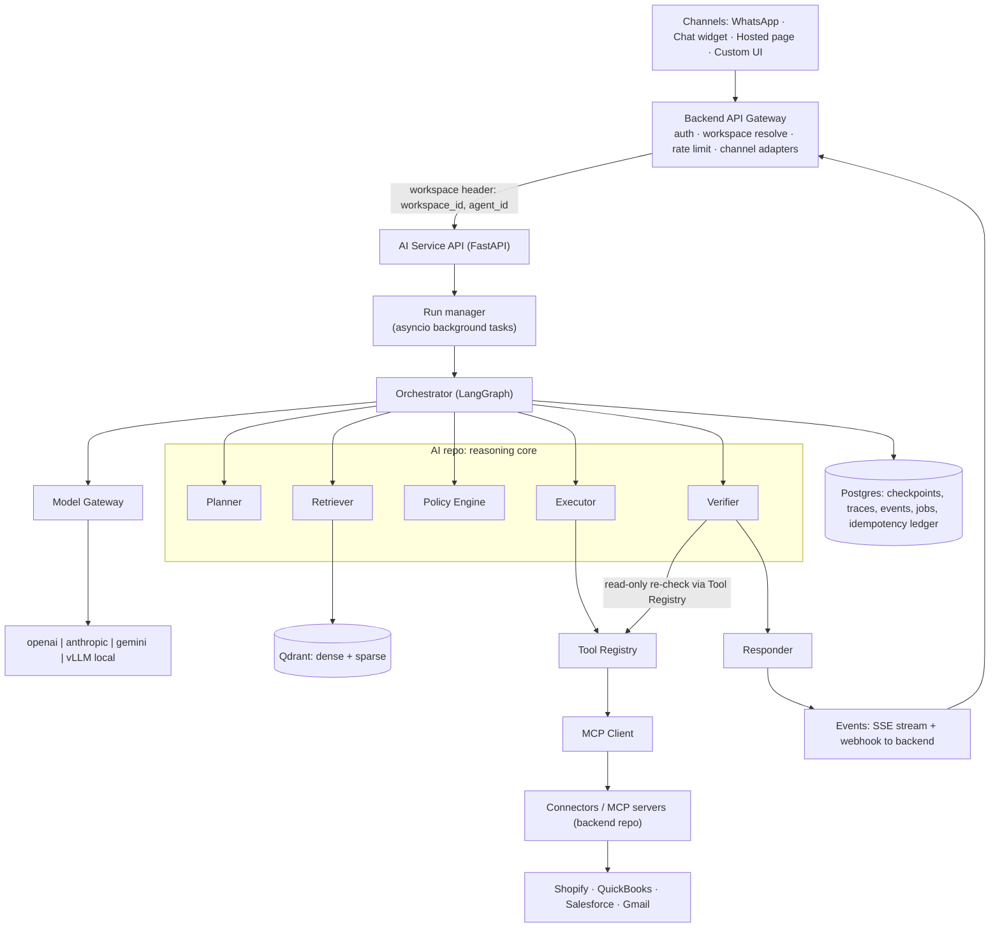
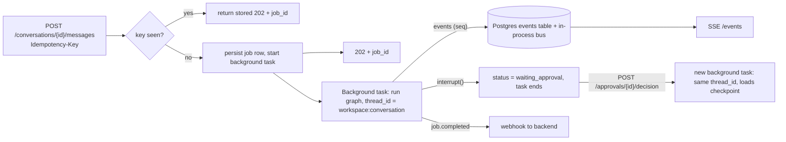
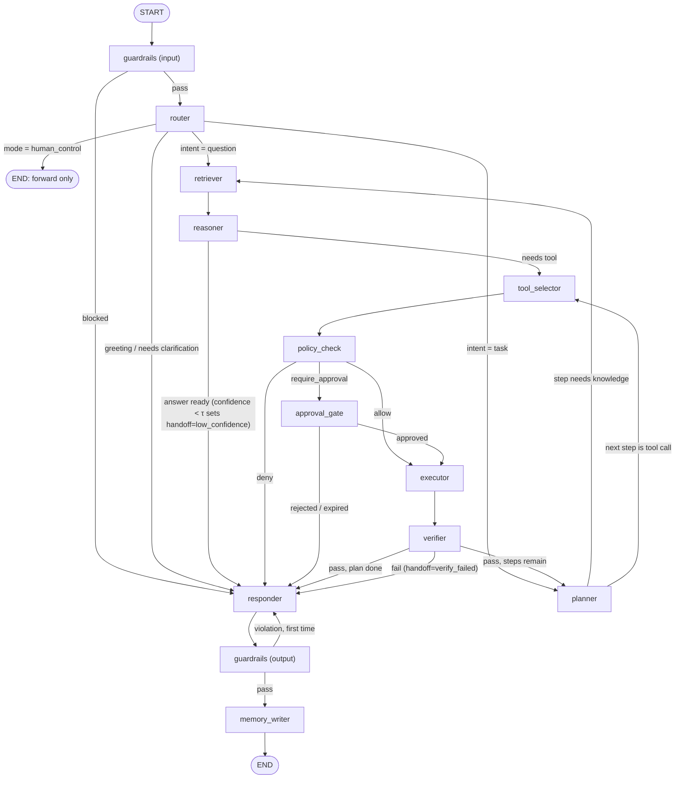
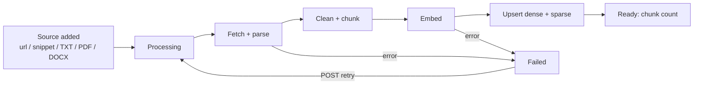

# Felops — AI System Design & Architecture

## 1. Executive note

- **V1 scope: each agent contains exactly one sub-agent, customer-support** (external, customer-facing, action-capable via tools). V1 ships no multi-sub-agent orchestration, no internal employee sub-agents and no sub-agent selection logic. Both are a later refactor, not a redesign. V1 ships only the seams: `AgentRef` in state and events, `SubAgentRegistry`, `SubAgentResolver`, a per-sub-agent persona (Prompt Registry), a per-sub-agent effective tool set (Tool Registry), and a documented graph insertion point (§4.1, §4.2, §6.6).
- **AI repo owns:** orchestration (LangGraph), retrieval and ingestion, model access, policy and verification, guardrails, evaluation. **Backend repo owns:** auth, workspaces, config persistence, billing, channel delivery, connectors, OAuth and MCP servers.
- **Interface:** REST for config and control (one dependency reads the workspace context from the `X-Workspace-Id` header), async jobs with webhooks for plan execution, and SSE for tokens and trace events. The backend is the source of truth for configuration. The AI repo holds only derived state: indexes, compiled prompts, effective tool sets, checkpoints, traces, events, jobs and the idempotency ledger.

**Terminology (used consistently in this document)**

| Term | Meaning | Id | V1 |
|---|---|---|---|
| **Agent** | The full agent the user creates in the wizard (e.g. "Customer Experience"). Holds the user-written instructions, knowledge sources, channels and the tool selection `S`. A container of sub-agents. | `agent_id` | Many agents per workspace |
| **Sub-agent** | A specialized, platform-defined unit inside an agent (customer_support, later billing, sales, HR, IT). Has its own persona prompt, its own predefined tool set and its own derived effective tool set. | `sub_agent_id` | Exactly one per agent: `customer_support` |

Rules: the backend always supplies `agent_id` (from the channel binding). The AI repo resolves `sub_agent_id`. Knowledge, instructions, channels and `S` are agent-level. Persona and effective tools are sub-agent-level.

---

## 2. System architecture (AI repo)

### 2.1 Layered view



### 2.2 Async pipeline



| Job type | Purpose | Notes |
|---|---|---|
| `interactive` | Live chat turns | Starts immediately as an asyncio task |
| `resume` | Post-approval resumes | Same `thread_id`, loads checkpoint |
| `ingest` | Parse, chunk, embed | Background task with status in Postgres. Sources left in `processing` after a restart are re-run on startup. |
| failed jobs | Transient errors | Retried with exponential backoff inside the task. After the retry limit the job becomes `failed` and an `error` event is emitted. |

- Checkpoints are written after every node. After a crash or restart, jobs left `running` are resumed from the last checkpoint on startup.
- Side effects are protected by the executor's idempotency ledger, not by task semantics.
- Every event except `message.delta` is stored in the Postgres `events` table with its `seq`. The table backs `/trace` and `Last-Event-ID` replay. Live delivery uses an in-process bus, so the dev phase runs a single API process.

### 2.3 Multi-workspace isolation (AI layer)

| Concern | Mechanism |
|---|---|
| `workspace_id` propagation | Set once at ingress by the `get_workspace_context()` dependency (`X-Workspace-Id` header) into a `WorkspaceContext` contextvar. Copied into graph state, the background-task context, MCP calls, log and trace baggage. Resume runs read it from their own request, and startup recovery rebuilds it from the job row. Repositories require it as a non-optional argument. |
| Knowledge namespaces | `NameSpace(workspace_id, agent_id, source_id)`. Knowledge is agent-level and shared by all of the agent's sub-agents. Default: shared collection per embedding model with indexed `workspace_id` payload. The `VectorStore` adapter rejects any query lacking a workspace filter. Enterprise tier: dedicated collection. |
| Model config | `ModelPolicy` per workspace: allowed providers, tier-to-model map, local-only flag for sensitive data, monthly budget cap. The UI's "Model: Automatic (by plan)" is the default tier map. |
| Prompts | Resolution order: workspace+agent+sub-agent override > workspace+sub-agent > platform sub-agent default > platform default. All pinned by version in `config_version`. |
| Agent scope | `AgentRef(agent_id, sub_agent_id, audience)` is resolved at ingress and pinned in graph state, checkpoint, events and usage records. V1: `sub_agent_id` is always `customer_support`, audience `external`. |
| State | Checkpoint `thread_id = {workspace_id}:{conversation_id}`. Cache keys are prefixed by workspace. |
| Credentials | The AI repo never stores connector secrets. MCP Client requests short-lived tokens from the backend per call. |
| Verification | Cross-workspace contract test runs in CI: two workspaces, identical queries, assert zero leakage in retrieval, memory and cache. |

---

## 3. Technology stack

| Component | Choice | Role | Why |
|---|---|---|---|
| Orchestration | LangGraph + `langgraph-checkpoint-postgres` | Stateful graph, durable `interrupt()` | Native pause and resume for approvals, checkpoint replay |
| Service | FastAPI + Pydantic v2 | AI Service API, typed contracts | Same stack as backend, shared OpenAPI |
| LLM gateway | In-house `ModelGateway`, LiteLLM as provider adapter, vLLM for local | Routing, fallback, metering | One adapter covers most providers. Routing policy stays ours. |
| Vector DB | Qdrant | Dense and sparse vectors, payload filters | Hybrid in one engine, workspace-indexed filters, self-hostable |
| Lexical (BM25) | Qdrant sparse vectors, IDF modifier | Keyword leg of hybrid | Avoids a separate search cluster |
| Embedding | BGE-M3 (self-hosted); OpenAI-compatible adapter as alternate | Multilingual dense vectors | Strong Arabic and English, 8k context. Inference runs in a thread pool so it never blocks the API event loop. |
| Reranker | bge-reranker-v2-m3; Cohere Rerank adapter | Cross-encoder rerank | Same multilingual coverage, local option. Runs in the same thread pool. |
| Parsing | Docling or Unstructured (PDF/DOCX/TXT), trafilatura (web) | Ingestion extraction | Layout-aware, Arabic-safe |
| Job runner | asyncio background tasks, Postgres `jobs` table | Async plans and ingestion | No broker needed at dev scale. Job state survives restarts. |
| Events | Postgres `events` table + in-process bus | Ordered per-conversation events, SSE and replay | One less service. `seq` gives ordering and `Last-Event-ID` replay. |
| State store | PostgreSQL | Checkpoints, traces, events, jobs, idempotency ledger | One transactional store for graph state and ledger |
| Observability | Langfuse, structured JSON logs | Traces, LLM spans, cost, error logs | Langfuse for prompt and LLM-level inspection |
| Evaluation | pytest-based harness, Ragas metrics, Langfuse datasets | Retrieval, trajectory, tool-call evals | Runs in CI and on sampled production traces |
| Guardrails | Presidio, Pydantic validators, local classifier model | PII, injection, output checks | Deterministic checks first, model checks second |

---

## 4. Modules

Modules marked **(§5)** implement a Protocol shown in §5. Their remaining methods are listed here.

| Module | Responsibility | Public interface | Benefit | Connects to |
|---|---|---|---|---|
| **Model Gateway** | Routes LLM calls by workspace policy (tier, privacy, cost, latency). Retry, fallback, token and cost metering. | `complete(req, route)`, `stream(req)`, `usage()` · wraps `LLMProvider` (§5) | Provider swap and failover without code change. Budget enforcement. | Planner, Reasoner, Verifier, Guardrails, Observability |
| **Embedding Service** | Batch and query embeddings, model versioning per index. | `embed_documents()`, `embed_query()`, `model_id` · `EmbeddingModel` (§5) | Re-index on model change without touching retriever. | Ingestion, Retriever, Memory |
| **Retriever** | Dense + BM25 in parallel, RRF fusion, rerank, top-k with citations and namespace filters. | `retrieve(query, ctx, k)` · `RetrievalStrategy` (§5) | Better recall than dense-only, strategy per agent. | Embedding, VectorStore, Reranker, Reasoner |
| **Prompt Registry** | Versioned templates resolved per workspace/agent/sub-agent/node. Composes the sub-agent's persona template with the agent-level wizard block (Role, Language & constraints, Response format). **Per-sub-agent seam: persona (§4.2).** | `resolve(name, ctx)` (`ctx` carries `agent_id`, `sub_agent_id`), `publish(draft)`, `pin(config_version)` · `PromptStore` (§5) | Prompt changes ship without deploys, with rollback and eval gating. A new sub-agent brings its own persona. | Planner, Reasoner, Responder, Evaluation |
| **Planner** | Turns a goal into a bounded plan over the active sub-agent's effective tools only: steps, dependencies, tool candidates. Caps on steps and time. Replans on failure. | `plan(state)`, `replan(state, failure)` | Prevents uncontrolled agent loops. Plans are inspectable. Cannot propose a tool the sub-agent does not hold. | Prompt Registry, Tool Registry, Model Gateway |
| **Tool Registry** | Holds the workspace catalog and computes each sub-agent's effective tool set (§4.1). Per-tool JSON schema, verifier spec, connector binding, side-effect class (read-only or side-effecting). Risk classification is backend-owned; the AI repo receives only the resolved requires_approval boolean **Per-sub-agent seam: effective tool set (§4.2).** | `catalog(workspace)`, `effective_for(agent_ref)`, `get(action_id)`, `validate_args(call)`, `recompute(config)` | Single definition feeds planner, policy, executor and verifier. Sub-agent sets cannot drift from the user's selection. | Sub-Agent Registry, Policy Engine, MCP Client, backend config push |
| **MCP Client** | Pooled MCP sessions, tool discovery, short-lived credential fetch, timeouts. | `call_tool(conn, tool, args, idem_key)`, `list_tools(conn)` · adapts `Connector` (§5) | Connectors are decoupled from orchestration. | Executor, Verifier, backend credential broker |
| **Executor** | Runs authorized calls. Idempotency ledger (side-effecting calls only; a read-only call gets no key and always runs live), transient-error backoff, `tool.*` events. | `execute(call) -> ToolOutcome`, `ledger.get(key)` | No duplicate side effects on retry or redelivery. | Tool Registry, MCP Client, Postgres |
| **Verifier** | Re-reads live system state using the action's verifier spec, through read-only calls that carry no `idem_key` and bypass the idempotency cache (§5.4). Compares expected vs actual. One check per executed call, no retry. | `verify(call, outcome) -> VerifierResult{passed, evidence, reason}` | Tool success is not treated as business success. | Tool Registry, MCP Client, Planner |
| **Policy Engine** | Returns `allow`, `require_approval` or `deny` from allowlist (the active sub-agent's effective tool set), the action's `requires_approval` flag, args (e.g. amount), actor. Risk classification stays in the backend. | `evaluate(call, ctx) -> Decision` | Governance in one auditable place. Last line of defense against out-of-set calls. | Tool Registry, Executor, approval gate |
| **Memory** | Short-term window plus rolling summary. Long-term customer facts, workspace-scoped. | `read(scope, q)`, `write(scope, items)`, `summarize(thread)` · `MemoryStore` (§5) | Context continuity across turns and channels at bounded token cost. | Conversation Manager, Retriever, Embedding |
| **Conversation Manager** | Thread state and mode: Active / Assistance requested / Human control / Closed. Message ordering, job-to-thread mapping. Holds `Thread.active_sub_agent_id` (V1: constant). | `append(msg)`, `set_mode(mode, actor)`, `get_thread(id)` | Agent is silenced under human control and resumes cleanly. Thread ownership is ready for sub-agent pinning. | Orchestrator, Memory, API layer |
| **Ingestion Pipeline** | Fetch, parse, clean, chunk, embed, upsert. Status machine, content-hash dedupe. | `ingest(source)`, `retry(source_id)`, `delete(source_id)`, `status(source_id)` | Idempotent, resumable, per-source failure isolation. | Parsers, Embedding, VectorStore, backend webhook |
| **Evaluation Harness** | Offline and CI suites: retrieval (Recall@k, MRR, nDCG), tool-call correctness, trajectory, groundedness. Samples production traces. | `run_suite(name, cfg)`, `compare(run_a, run_b)` | Every swap in §5 is gated by measured regression. | All modules, Langfuse, CI |
| **Guardrails** | Input: injection, PII. Output: groundedness, cross-workspace leakage, language, forbidden content. | `check_input(msg)`, `check_output(draft, ctx)` | Enforces the agent's constraints deterministically. | Orchestrator, Model Gateway, Retriever |
| **Sub-Agent Registry** (seam) | Loads `SubAgentSpec` manifests: `sub_agent_id`, audience, predefined tool ids, persona template refs. Resolves the `AgentRef` for a request. V1 ships one sub-agent: `customer_support`. | `get(sub_agent_id)`, `enabled(ctx)`, `resolve(req, ctx)` · `SubAgentRegistry`, `SubAgentResolver` (§5) | A new sub-agent is a manifest plus persona templates, with no change to existing modules. | Tool Registry, Prompt Registry, Conversation Manager, application layer |

### 4.1 Tool hierarchy and effective tool sets

Tool access is resolved through four levels. The user touches only the agent-level selection `S`.

| Level | Symbol | Owner | User-visible | Illustrative ids |
|---|---|---|---|---|
| Workspace tool catalog | `C` | Backend (workspace actions), pushed to the AI repo | yes | `[0,1,2,3,4,5,6,7]` |
| Sub-agent predefined set | `P_s` | AI repo, platform-owned manifest | **no** | `P(customer_support)=[0,2,4,6]`, `P(billing)=[0,1,3,5]` |
| Agent tool selection | `S ⊆ C` | User at agent creation (wizard step 3), persisted by the backend | yes | `[0,2,4,5]` |
| Sub-agent effective set | `E_s = P_s ∩ S` | Tool Registry, derived | **no**, never editable | `E(customer_support)=[0,2,4]`, `E(billing)=[0,5]` |

Propagation. The user edits only `S`, and every sub-agent's set follows:

| Agent selection `S` | `E(customer_support)`, `P=[0,2,4,6]` | `E(billing)`, `P=[0,1,3,5]` |
|---|---|---|
| `[0,2,4,5]` | `[0,2,4]` | `[0,5]` |
| `[0,2,5]` (user drops 4) | `[0,2]` | `[0,5]` |
| `[2,5]` (user drops 0) | `[2]` | `[5]` |
| `[0,1,2,3,4,5,6,7]` | `[0,2,4,6]` | `[0,1,3,5]` |

Tool 7 is in no predefined set, so no sub-agent can use it even when selected.

**Invariants**
1. `E_s = P_s ∩ S` is recomputed by `ToolRegistry.recompute()` on every `PUT /agents/{id}/config`. It is never an input field. No endpoint accepts `E_s`, and the user never edits a sub-agent's tool set.
2. Excluding a tool from `S` removes it from every sub-agent whose `P_s` contained it, with no further action. The allowlist is evaluated at call time, including on approval resume (§6.5), so a removal also revokes pending approvals for that tool.
3. `P_s` is versioned with the code and never leaves the AI repo. `config:validate` returns only the derived `E_s`, and the backend must not render predefined sets.
4. `S ⊆ C` is validated. A selected id that is in no enabled sub-agent's `P_s` yields the warning `tool_unreachable`.
5. The `requires_approval` flag is per (agent, action) and applies to every sub-agent that holds the action. It is resolved by the backend (the tool author's critical flag composed with the user's wizard toggle) and delivered to the AI repo as a single boolean. The AI repo does not model risk or a policy floor.
6. Every consumer (planner, `tool_selector`, policy, executor, verifier) obtains tools only through `effective_for(agent_ref)`.
7. `effective_tools(P, S)` is a pure function in the domain layer. Property tests assert `E ⊆ P`, `E ⊆ S`, monotonicity in `S`, and idempotence. The tool-call eval suite asserts zero executed calls outside `E`.

**V1 instantiation.** Only the `customer_support` sub-agent is enabled, so `E = P(customer_support) ∩ S`, where `S` comes from wizard step 3. The six catalog actions in the UI are in `P(customer_support)`. Refund order, when unchecked, is absent from `E` and cannot be planned, approved or executed.

### 4.2 Per-sub-agent seams

**Each sub-agent has its own persona prompt (Prompt Registry) and its own effective tool set (Tool Registry).** These are the two per-sub-agent seams. Agent-level settings (user instructions, knowledge, channels, selection `S`) are shared by all of the agent's sub-agents. Everything else in the runtime is shared.

| Seam | Where | Keyed by | V1 value | When a sub-agent is added |
|---|---|---|---|---|
| **Persona prompt** | Prompt Registry (`PromptStore`) | `(workspace, agent_id, sub_agent_id, node)` | `customer_support` persona template plus the agent-level wizard block (Role, Language & constraints, Response format) | Add persona templates for the new `sub_agent_id`. Resolution order in §2.3. |
| **Effective tool set** | Tool Registry | `AgentRef` + `config_version` | `P(customer_support) ∩ S` | Add a manifest with predefined ids. Sets derive per §4.1. |
| Identity | Domain `AgentRef(agent_id, sub_agent_id, audience)` | state, checkpoint, events, usage | `sub_agent_id` constant | none |
| Sub-agent manifest | `SubAgentRegistry` | `sub_agent_id` | one file manifest | add a manifest, enable per workspace in config |
| Resolution | `SubAgentResolver` | `agent_id` from request, channel, thread | `StaticResolver`: always `customer_support` | channel-to-audience strategy (§6.6) |
| Thread ownership | Conversation Manager | `Thread.active_sub_agent_id` | the one sub-agent | pins the selected sub-agent for the thread |
| Event and usage attribution | Event envelope, `usage.recorded` | `agent_id`, `sub_agent_id` | `sub_agent_id` constant | per-sub-agent analytics with no schema change |

---

## 5. Modularity and extensibility

**Rule:** every swappable component sits behind a Protocol in `ports/`. Swapping one means implementing the Protocol, registering the adapter, and changing config. Orchestration code is never edited.

Adding a sub-agent is not a swap. It is a manifest plus persona templates plus eval suites, and it needs the §6.6 node once a second sub-agent exists.

Enforcement:
- `import-linter` contract: `orchestrator/` may import only `ports/` and `domain/`.
- One shared contract test suite per Protocol, run against every adapter in CI.
- Property tests for `effective_tools` (§4.1).

### 5.1 Interface boundaries

```python
class LLMProvider(Protocol):          # openai | anthropic | gemini | local
    capabilities: ProviderCaps        # tools, json_mode, max_ctx
    async def complete(self, req: LLMRequest) -> LLMResponse: ...
    def stream(self, req: LLMRequest) -> AsyncIterator[LLMChunk]: ...

class VectorStore(Protocol):          # qdrant | pgvector | weaviate | pinecone
    async def upsert(self, ns: NameSpace, items: list[VectorItem]) -> None: ...
    async def search(self, ns: NameSpace, q: HybridQuery, k: int) -> list[Hit]: ...
    async def delete(self, ns: NameSpace, flt: Filter) -> int: ...

class EmbeddingModel(Protocol):
    model_id: str; dim: int
    async def embed_documents(self, texts: list[str]) -> list[Vector]: ...
    async def embed_query(self, text: str) -> Vector: ...

class PromptStore(Protocol):          # versioned, per-workspace, per-agent, per-sub-agent
    def resolve(self, name: str, ctx: PromptContext) -> PromptVersion: ...   # ctx.agent_id, ctx.sub_agent_id

class RetrievalStrategy(Protocol):    # dense | hybrid_rrf | hybrid_rerank | graph (later)
    async def retrieve(self, q: Query, ctx: WorkspaceCtx) -> list[Chunk]: ...

class Connector(Protocol):            # MCP server, REST connector, native SDK
    async def list_tools(self, ctx: WorkspaceCtx) -> list[ToolSpec]: ...
    async def call(self, tool: str, args: dict, ctx: WorkspaceCtx, idem_key: str | None = None) -> ToolResult: ...  # idem_key set iff side-effecting; reads pass None (§5.4)

class MemoryStore(Protocol):          # postgres | redis | vector-backed
    async def read(self, scope: MemoryScope, q: str | None) -> list[MemoryItem]: ...
    async def write(self, scope: MemoryScope, items: list[MemoryItem]) -> None: ...

class SubAgentRegistry(Protocol):     # file manifests (V1) | db-backed (later)
    def get(self, sub_agent_id: str) -> SubAgentSpec: ...   # sub_agent_id, audience, predefined_tool_ids, persona refs
    def enabled(self, ctx: WorkspaceCtx) -> list[SubAgentSpec]: ...

class SubAgentResolver(Protocol):     # static (V1) | channel_audience (later)
    def resolve(self, req: ResolveRequest, ctx: WorkspaceCtx) -> AgentRef: ...  # agent_id, channel, thread -> AgentRef
```

### 5.2 Selection by config

```yaml
workspace: acme
llm:        {provider: anthropic, tiers: {fast: <id>, standard: <id>, reasoning: <id>}, fallback: openai}
vector:     {store: qdrant, mode: shared}
embedding:  {model: bge-m3}
retrieval:  {strategy: hybrid_rerank, k: 8, rerank_k: 40}
memory:     {backend: postgres}
sub_agents: {enabled: [customer_support], resolver: static}
```

| Swap point | Implementations | Config key |
|---|---|---|
| LLM provider | openai, anthropic, gemini, vLLM | `llm.provider` |
| Vector store | qdrant, pgvector, weaviate, pinecone | `vector.store` |
| Embedding | bge-m3, OpenAI-compatible | `embedding.model` |
| Prompts | DB-backed, file-backed (dev) | `prompts.source` |
| Retriever | dense, hybrid_rrf, hybrid_rerank | `retrieval.strategy` |
| Tools | MCP, REST, native | per-action `connector` |
| Memory | postgres, redis | `memory.backend` |
| Sub-agents and resolver | file manifests, static (V1); db manifests, channel_audience (later) | `sub_agents.enabled`, `sub_agents.resolver` |

### 5.3 Design patterns

| Pattern | Where |
|---|---|
| **Ports & Adapters** | `ports/` Protocols with `adapters/` per vendor. Orchestrator depends only on ports. |
| **Strategy** | `RetrievalStrategy`, model routing policy, chunking strategy per source type, sub-agent resolution policy (`SubAgentResolver`). |
| **Factory** | Registry builds adapters from config (`build_llm(cfg)`, `build_vector_store(cfg)`), cached per workspace config version. |
| **Adapter** | LiteLLM to `LLMProvider`. MCP session to `Connector`. Qdrant client to `VectorStore`. |
| **Repository** | Checkpoints, traces, idempotency ledger, prompt versions. Postgres hidden behind interfaces. |
| **Chain of Responsibility** | Policy rules (allowlist, requires_approval, amount threshold, rate limit). Guardrail checks. Gateway fallback chain. |

---

## 6. LangGraph state graph

### 6.1 State schema

```python
class AgentState(TypedDict):
    workspace_id: str
    agent_id: str                         # the user-created agent, supplied by the backend
    sub_agent_id: str                     # V1: "customer_support"; set at ingress, pinned
    audience: Literal["external", "internal"]   # V1: "external"
    channel: str                          # whatsapp | widget | hosted | api (later: employee portal)
    conversation_id: str
    config_version: str
    messages: Annotated[list[Message], add_messages]
    plan: Plan | None                     # steps, deps, cursor
    retrieved_context: list[Chunk]
    tool_calls: list[ToolCall]            # proposed + executed, with params_hash; idem_key only on side-effecting calls
    pending_approvals: list[Approval]
    execution_trace: Annotated[list[TraceEvent], operator.add]
    verifier_result: VerifierResult | None
    confidence: float
    handoff: HandoffReason | None
```

### 6.2 Nodes

| Node | Calls | Writes |
|---|---|---|
| `guardrails` (in/out) | Guardrails | `messages` (sanitized), `handoff` on violation |
| `router` | Conversation Manager, small LLM | route, `plan` stub |
| `planner` | Planner (persona and effective tools for `sub_agent_id`) | `plan` |
| `retriever` | Retriever | `retrieved_context` |
| `reasoner` | Model Gateway (persona for `sub_agent_id`) | draft, `confidence`, next action |
| `tool_selector` | Tool Registry `effective_for(agent_ref)` | `tool_calls` (args validated) |
| `policy_check` | Policy Engine (allowlist = sub-agent's effective set) | decision per call |
| `approval_gate` | `interrupt()` | `pending_approvals` |
| `executor` | Executor | `tool_calls[].outcome` |
| `verifier` | Verifier | `verifier_result` |
| `responder` | Model Gateway, Prompt Registry | final message |
| `memory_writer` | Memory | long-term facts, thread summary |

No node is added for multi-sub-agent support. Every node resolves persona and tools from `(agent_id, sub_agent_id)` in state, so adding sub-agents does not change node code.

### 6.3 Graph



### 6.4 Edges

| From → To | Condition |
|---|---|
| START → guardrails(in) | always |
| guardrails(in) → router / responder | pass / blocked (refusal text). **The pass edge is the sub-agent selection insertion point (§6.6).** |
| router → END | conversation mode is Human control; message is forwarded, no agent reply |
| router → retriever / planner / responder | intent is question / task / greeting or ambiguous |
| planner → retriever / tool_selector | next plan step is knowledge / tool |
| retriever → reasoner | always |
| reasoner → tool_selector / responder | model requests a tool / answer ready |
| reasoner → responder (`handoff=low_confidence`) | `confidence < τ` (per-agent) |
| tool_selector → policy_check | always, one pass per call |
| policy_check → executor / approval_gate / responder | allow / approval required / deny |
| approval_gate → executor / responder | approved / rejected, expired, revoked authority, or tool removed from the effective set |
| executor → verifier | always (non-transient error yields `passed=false` with reason) |
| verifier → planner / responder | pass with steps left / plan done |
| verifier → responder (`handoff=verify_failed`) | fail |
| responder → guardrails(out) → memory_writer → END | pass. On violation: regenerate once, then fixed safe fallback. |

### 6.5 Conditional routing

1. **Approval pause and resume.** `policy_check` returns `require_approval`. `approval_gate` persists an immutable params snapshot, emits `approval.required`, and calls `interrupt()`. The job becomes `waiting_approval` and the run's background task ends. `POST /approvals/{id}/decision` starts a new background task that resumes the thread with `Command(resume={decision, approver_id})`. On resume the gate checks `params_hash`, TTL, connection health and that the action is still in the sub-agent's effective tool set before routing to `executor`.
2. **Verifier failure.** Route to `responder` with `handoff=verify_failed`. There is no re-verify and no re-execution. Conversation mode becomes Assistance requested. The agent never claims success.
3. **Low confidence.** `confidence < τ`, or a retrieval miss on a policy-sensitive topic, routes to `responder` with a handoff message. A human takes over with the plan, retrieved context and actions already taken attached.

### 6.6 Extension point: sub-agent selection (documented, not built in V1)

**Position:** the edge `guardrails(in) → router`. Selection runs after input sanitization and before intent routing, because router, planner and reasoner behave differently per sub-agent.

```text
V1:      START → guardrails(in) → router → …                                 AgentRef resolved at ingress
Future:  START → guardrails(in) → sub_agent_selector → router → …            sub_agent_id resolved in-graph
```

| Aspect | V1 | Future `sub_agent_selector` node |
|---|---|---|
| Who resolves `AgentRef` | The submit-message use case calls `SubAgentResolver` (`StaticResolver`: always `customer_support`) and writes `agent_id`, `sub_agent_id`, `audience` into initial state | The node calls the same `SubAgentResolver` and writes `sub_agent_id` and `audience`. `agent_id` is already in state. |
| Inputs | `agent_id` from the request | `channel`, channel-to-audience map (config), `Thread.active_sub_agent_id`, sanitized message |
| Routing | none | External channels (WhatsApp, chat widget, hosted page, Custom UI API) route to the agent's external sub-agents. Internal channels (employee portal) route to its internal sub-agents (HR, IT). |

Rules for the future node:
- Routing policy lives behind `SubAgentResolver` (Strategy). The node only calls it and writes state.
- The node selects only `sub_agent_id`. `agent_id` always comes from the backend's channel binding and is never chosen or changed by the AI repo.
- Audience is derived from `channel` via config, never from message content, so prompt injection cannot flip an external conversation to an internal sub-agent.
- Selection runs on fresh turns only. `resume` jobs restore a checkpoint with `agent_ref` already pinned and skip it.
- Once selected, `Thread.active_sub_agent_id` pins the sub-agent for the thread. Switching sub-agents mid-thread is an explicit handoff and out of scope.
- Downstream nodes are unchanged because persona and tools are resolved from state (§4.2).
- Adoption is three edits: register the node, replace the one edge, and stop resolving `sub_agent_id` at ingress.

---

## 7. AI ↔ Backend API contract

**Schema choice**
- **REST + JSON (OpenAPI)** for config and control. Synchronous, debuggable, and generates typed clients for the backend.
- **Async job pattern** for plan execution: `202 + job_id`, then a webhook. Plans exceed gateway timeouts and may pause for hours on approval.
- **SSE** for token and trace streaming. It is one-way, works through standard proxies, and reconnects with `Last-Event-ID`. Control actions stay on REST, so WebSocket's bidirectionality adds nothing.
- The backend proxies SSE to clients. WhatsApp receives `message.final` only.
- The public `/v1/agents/{id}/conversations` in the docs screen is backend-owned and maps to the contract below.

**Workspace context:** one `get_workspace_context()` dependency reads `workspace_id` from the `X-Workspace-Id` header. Every AI-service request carries this header.

### 7.1 Endpoints

In every path below, `{id}` under `/agents/` is the `agent_id`.

| Method | Path | Request | Response | Async |
|---|---|---|---|---|
| POST | `/agents/{id}/config:validate` | Wizard draft (instructions, source ids, action ids, channels) | `{valid, errors[], warnings[]}` | no |
| PUT | `/agents/{id}/config` | Versioned runtime config snapshot | `{config_version, compiled_prompt_id}` | no |
| POST | `/agents/{id}/preview` | `{message, draft_config?}`; side-effecting tools mocked | SSE stream | stream |
| PUT | `/actions/{id}` | Schema, verifier spec, connection ref | `{action_version}` | no |
| POST | `/knowledge-sources` | `{agent_id, type: url\|text\|txt\|pdf\|docx, ref, name}` | `202 {source_id, status: processing}` | yes |
| GET | `/knowledge-sources/{id}` | n/a | `{status, chunks, error?}` | no |
| POST | `/knowledge-sources/{id}/retry` | n/a | `202` | yes |
| DELETE | `/knowledge-sources/{id}` | n/a | `204` (purges vectors) | no |
| POST | `/conversations/{id}/messages` | Header `Idempotency-Key`; `{agent_id, channel, sender, content, locale}` | `202 {job_id}` | **yes** |
| GET | `/conversations/{id}/events` | Header `Last-Event-ID` | SSE stream (§7.2) | stream |
| GET | `/jobs/{job_id}` | n/a | `{status: queued\|running\|waiting_approval\|done\|failed}` | no |
| GET | `/conversations/{id}/trace` | n/a | Ordered trace events | no |
| POST | `/conversations/{id}/mode` | `{mode: human_control\|active\|closed, actor}` | `200` | no |
| POST | `/approvals/{id}/decision` | `{decision, approver_id, note?}` | `202 {job_id}` | yes |
| POST | `{backend}/webhooks/ai` | `job.completed`, `approval.required`, `ingestion.status`, `usage.recorded` | `2xx` | n/a |
| GET | `{backend}/connections/{id}/token` | n/a | Short-lived credential | no |

Backend-owned lists (conversations, approval queue and history, execution history) are projections of AI events. The AI repo exposes no list endpoints for them.

**Additive seam fields.** These are optional, V1 clients may ignore them, and no path, method or existing field changes:
- `PUT /agents/{id}/config` and `config:validate`: the action ids in the snapshot are the agent's tool selection `S` (§4.1). Optional `sub_agents` (list of `sub_agent_id`) defaults to `["customer_support"]`. Any other value returns the error `sub_agent_unsupported`.
- `config:validate` response: optional `effective_tools` (derived `E_s`, a map `{sub_agent_id: [action ids]}`) and the warning code `tool_unreachable`. Predefined sets are never returned.
- `POST /conversations/{id}/messages`: the request is unchanged. `agent_id` identifies the agent. The backend never sends `sub_agent_id`, because the AI repo resolves it (§6.6).
- Event envelope: `agent_id`, `sub_agent_id` (§7.2).

### 7.2 Event vocabulary

Envelope: `{event_id, seq, ts, type, workspace_id, agent_id, sub_agent_id, conversation_id, job_id, data}`. `seq` is monotonic per conversation.

| Event | Emitted by | `data` keys |
|---|---|---|
| `plan.created` | planner | steps[] |
| `retrieval.completed` | retriever | sources[], chunk_count |
| `tool.started` | executor | call_id, action, integration, params_summary |
| `tool.completed` | executor | call_id, status, result_summary, initiated_by (`auto` \| member id) |
| `approval.required` | approval_gate | approval_id, action, integration, params, params_hash, effect_summary, expires_at |
| `approval.resolved` | approval_gate | approval_id, decision, approver_id |
| `verifier.passed` / `verifier.failed` | verifier | call_id, evidence, reason |
| `handoff.requested` | responder | reason |
| `message.delta` | responder | text |
| `message.final` | responder | message_id, text, citations[] |
| `usage.recorded` | gateway, executor | tokens, cost, executions |
| `error` | any | code, retryable, message |

---

## 8. End-to-end workflow traced through the UI

### 8.1 Create Agent wizard

| Step | UI | AI repo stores | AI repo validates |
|---|---|---|---|
| 1. Name & Instructions | Agent name, Role, Language & constraints, Response format | Compiled agent-level instruction block: four sections mapped to template slots, versioned in Prompt Registry, composed at runtime with the `customer_support` sub-agent persona | Token budget, supported languages (English, Arabic), injection patterns in free text, contradictions with platform-level rules |
| 2. Knowledge | Website URL, Text snippet, TXT, PDF, DOCX; per-source status | Source records, chunks and vectors under `NameSpace(workspace, agent, source)` | Reachability, mime and size limits, content-hash duplicates. Continue allowed while Processing; a Failed source becomes a review warning. |
| 3. Actions | Six actions with checkbox and Approval toggle | The user's selection `S` (subset of the workspace catalog) and per-action approval flag. Tool Registry derives `E(customer_support) = P(customer_support) ∩ S` and compiles it into the sub-agent's view (§4.1). | Approval composition (the tool author's critical flag OR the user's toggle) is resolved by the backend before this call; the AI repo receives only the resolved `requires_approval` boolean. |
| 4. Channels | Chat widget, Hosted page, Custom UI (API), WhatsApp | Channel-to-agent binding metadata used for capability flags and by `StaticResolver` | Channel capabilities: streaming on widget, hosted page and API; none on WhatsApp (final message only) |
| 5. Preview & Review | Counts: sources and chunks, allowed actions, approvals required, channel status | Dry-run result | `config:validate` returns readiness report, with action counts computed from `E`. `/preview` runs the real graph with write tools mocked and read tools live. |
| Activate | Activate agent | Pinned `config_version` | Warm prompt and tool caches, confirm namespace is non-empty. Backend flips status after `200`. |

Draft persistence ("Save draft") is backend-side. AI validation is stateless. The V1 wizard has no sub-agent picker: every agent has the one `customer_support` sub-agent, and the backend may omit `sub_agents`.

### 8.2 Agent runtime: Conversation #1042, Sara Ali

| # | UI behavior | AI repo behavior | Event |
|---|---|---|---|
| 1 | Sara asks "Where is my order #1042?" via WhatsApp, chat widget or hosted page | Backend posts the message with `agent_id`. AI returns `202 + job_id`. The use case resolves `AgentRef` (`agent_id` from the request, `sub_agent_id` = `customer_support`, external) into state. Guardrails pass, router sees task intent. | n/a |
| 2 | Agent replies "Let me check…" | Planner builds the plan: lookup order, then answer. Retriever pulls shipping-policy chunks from Customer Experience sources. | `plan.created`, `retrieval.completed` |
| 3 | Trace row "Looked up order · Shopify · Done" | `tool_selector` picks `Lookup order` from the sub-agent's effective set (Custom API, Shopify, `GET /orders/1042`). Policy: allow, no approval. Executor calls via MCP. | `tool.started`, `tool.completed` |
| 4 | Agent: shipped, tracking #TRK8812 | Reasoner grounds the reply in the tool result. Output guardrails pass. | `message.delta`, `message.final` |
| 5 | Sara: "send me the invoice" | New turn. Plan: `Send invoice` (QuickBooks), params invoice #, amount, recipient email. | `plan.created` |
| 6 | Card: "Action is waiting for approval" with Approve / Reject. Trace row "Send invoice · QuickBooks · Pending". | `policy_check`: the allowlist rule passes, then the approval rule returns `require_approval`. Gate snapshots params, renders `effect_summary` from a deterministic template (never free LLM text), calls `interrupt()`. | `approval.required` |
| 7 | Agent tells Sara an authorized member will approve | Responder emits the holding message. Job state `waiting_approval`. | `message.final` |
| 8 | Authorized member approves in Approvals | Backend checks the "Approve actions" permission, then calls `/approvals/{id}/decision`. Graph resumes. Gate verifies `params_hash`, connection health and effective-set membership. | `approval.resolved` |
| 9 | Execution history shows "Invoice INV-2210 sent", initiated by the approver | Executor runs with the ledger key. `initiated_by` is the approver's id. | `tool.started`, `tool.completed` |
| 10 | Trace shows Done | Verifier calls the read-only QuickBooks check from the verifier spec (invoice exists, status sent, recipient matches). Mismatch triggers §6.5 case 2. | `verifier.passed` |
| 11 | Sara receives the invoice confirmation | Responder emits `message.final` as a proactive turn on the same thread. Backend delivers it through the channel adapter. | `message.final`, `job.completed` |

Takeover, as in "Human takeover — Omar Farouk joined": `/mode` sets Human control. The router stops agent replies, and the AI keeps appending inbound messages to the thread for context.

### 8.3 Approvals queue

| UI | AI repo |
|---|---|
| Pending: action, integration, conversation, customer, age | Backend projects from `approval.required`. |
| Detail: requested action, integration, originating conversation, requester ("Customer Experience on behalf of Sara Ali"), parameters, effect sentence | All fields come from the frozen payload. The effect sentence is `effect_summary`. |
| Approve / Reject | Resume with decision. Reject routes to `responder` ("execution stopped") and records `Rejected` in the trace. |
| History: decision, decider, time | Backend persists from `approval.resolved`. The AI trace keeps the decision and `approver_id`. |

### 8.4 Execution history

Each row maps to one `tool.completed` event:
- **Action, Integration:** action definition.
- **Result:** `result_summary`, a per-action template such as "Email sent to {recipient}".
- **Initiated by:** `auto` or the approver's id.
- **Time:** event `ts`.
- **Rejected:** the executor is never invoked. `approval.resolved` with `decision=rejected` is projected as "Rejected — execution stopped".
- Dashboard counters (executions 24h, failed and retried) are backend aggregates over these events plus `error`.

### 8.5 Knowledge ingestion



- **Chunking:** structure-aware, with section headings carried in chunk metadata. Arabic text is normalized (diacritics, alef/yā variants) before the BM25 leg. The source's content hash makes ingestion idempotent.
- **Status:** `ingestion.status` webhooks carry `processing`, `ready`, `failed` and `chunks`.
- **Retry:** `POST /knowledge-sources/{id}/retry` is the "Retry available" action on a failed DOCX like `onboarding-guide.docx`.
- **Delete:** purges vectors by `source_id`.

---

## 9. Future features

- **Multiple sub-agents per agent (support, billing, sales, …):** each new sub-agent is a `SubAgentSpec` manifest (predefined tool ids), persona templates and eval suites. Add the `sub_agent_selector` node at the §6.6 edge. Effective tool sets follow from §4.1 with no extra configuration. Add sub-agent-specific nodes only if a sub-agent needs a different topology.
- **Internal employee sub-agents (HR, IT, …):** `audience=internal` sub-agents, selected by channel through the same §6.6 node, with identity-aware retrieval and employee-scoped actions (see the portals bullet).
- **Neo4j knowledge graph:** multi-hop reasoning (customer → invoice → contract → ticket). Per-workspace configurable ontology. A `graph` `RetrievalStrategy` added behind the existing port, with no orchestrator change.
- **Temporal.io (Durable Execution Engine).** Introduces Temporal to handle long-running, scheduled, and time-bound enterprise workflows, augmenting LangGraph (which handles the cognitive steps).
  - **Durable Timers & SLAs:** Native long-lived timers (days/weeks) for SLA detection (e.g., escalating a ticket open past a threshold) without holding worker resources.
  - **Scheduled & Recurring Workflows:** Native cron-like scheduling for recurring agent runs (e.g., monthly billing reviews, contract renewals).
  - **Guaranteed Execution:** Automatic state recovery and infinite retries for external system calls, ensuring side effects complete even during long infrastructure failures.
  - **Architecture Shift:** LangGraph remains the cognitive orchestrator (LLM calls, tool selection); Temporal wraps the overall process, managing durable state, multi-day pauses, and scheduled triggers.
- **Internal company portals:**
  - Provisioning portal for companies to create and manage agents for their own clients. This needs hierarchical workspaces (`parent_workspace_id`), inherited policy and model config, and cross-client isolation tests.
  - Employee portal with identity-aware retrieval (ACL-filtered knowledge) and employee-scoped actions.
- **Voice agent channel:** streaming STT and TTS adapters in front of the same graph, barge-in handling, and a latency budget for the `interactive` jobs.

---

## 10. Non-goals

- **Multiple sub-agents and internal sub-agents (V1):** each agent ships with one `customer_support` sub-agent. The seams exist (§4.2, §6.6), but there is no selection node, no second sub-agent, and no cross-sub-agent handoff.
- **User-editable sub-agent tool sets:** the user selects only the agent-level subset `S`. Predefined sets are platform-owned, and effective sets are derived.
- **Authentication and authorization:** the backend authenticates users and enforces roles. The AI repo trusts the workspace context the backend supplies (`X-Workspace-Id` header) and enforces only agent-level policy.
- **Billing and plan limits:** the AI repo emits `usage.recorded`. Metering, quotas and invoicing are backend.
- **Multi-workspace config persistence:** the AI repo keeps no workspace, member or agent source of truth, only derived artifacts.
- **UI:** no dashboards, builders, approval screens or notification rendering. The AI repo emits events and the frontend renders them.
- **Connector and OAuth flows:** OAuth, token refresh, credential storage and connector or MCP server implementations (Odoo included) are backend. The AI repo is an MCP client.
- **Channel delivery:** WhatsApp, widget and hosted-page transport and webhooks are backend. The AI repo emits messages.
- **Mobile app:** out of scope for the AI repo. It consumes the same events through the backend.