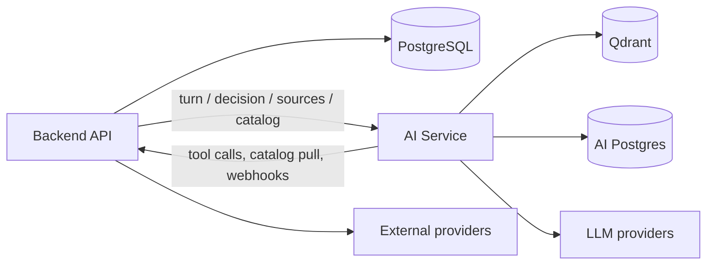
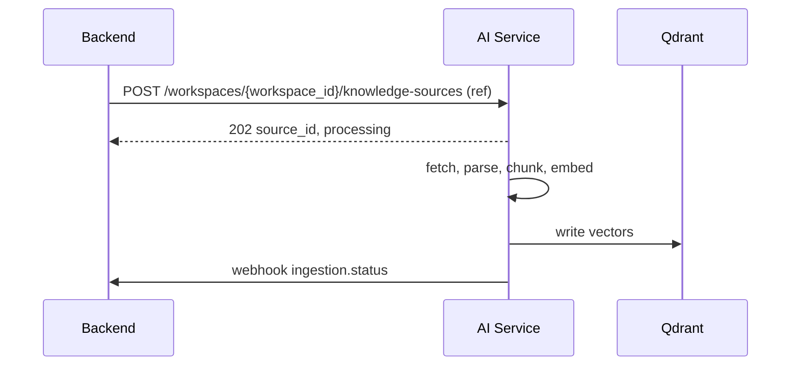

# AI Service Integration Contract

**Call direction**

- Backend API → AI Service: incoming turn, approval decision, knowledge source add / retry / delete, catalog push, validate / preview / mode.
- AI Service → Backend API: tool calls, catalog pull, webhooks.
- The AI Service returns results asynchronously: SSE events and webhooks (§9).
- The AI Service also calls Qdrant and LLM providers.
- The Backend owns tool execution, credentials, executions, the approval queue and history, and the conversations/messages tables.

## 1. System



The Backend owns PostgreSQL, the system catalog, agent configs (tool selection and approval flags), credentials, executions, the approval queue and history, and conversation messages. It sends the agent config with every request and executes every tool call.

The AI Service owns orchestration, retrieval, knowledge ingestion, and its own Postgres (LangGraph checkpoints, jobs, events, idempotency ledger, catalog copy). Checkpoints hold agent state and message history for orchestration; they are separate from the Backend's conversations/messages tables, which serve frontend history. The AI Service keeps no agent config of its own; it has no endpoint to create or read one.

## 2. Authentication

All internal requests use a bearer token over TLS. Every request to the AI Service is scoped under `/workspaces/{workspace_id}/`, which the AI Service trusts (the catalog push is global and needs no workspace parameter).

| Caller → receiver    | Token                    |
| -------------------- | ------------------------ |
| AI Service → Backend | `AI_IDENTITY_TOKEN`      |
| Backend → AI Service | `BACKEND_IDENTITY_TOKEN` |

| Flow                    | Endpoint                                                              | Auth          |
| ----------------------- | --------------------------------------------------------------------- | ------------- |
| Send a turn             | `POST /workspaces/{workspace_id}/conversations/{conversation_id}/messages` (AI Service) | Backend token |
| Approval decision       | `POST /workspaces/{workspace_id}/approvals/{approval_id}/decision` (AI Service)         | Backend token |
| Add knowledge source    | `POST /workspaces/{workspace_id}/knowledge-sources` (AI Service)                        | Backend token |
| Source status           | `GET /workspaces/{workspace_id}/knowledge-sources/{source_id}` (AI Service)             | Backend token |
| Retry source            | `POST /workspaces/{workspace_id}/knowledge-sources/{source_id}/retry` (AI Service)      | Backend token |
| Delete source           | `DELETE /workspaces/{workspace_id}/knowledge-sources/{source_id}` (AI Service)          | Backend token |
| Delete an agent's sources | `DELETE /workspaces/{workspace_id}/agents/{agent_id}/knowledge-sources` (AI Service)  | Backend token |
| Push catalog            | `PUT /catalog` (AI Service)                                           | Backend token |
| Validate, preview, mode, events, jobs, trace | see §8 (AI Service)                      | Backend token |
| Call a tool             | `POST /internal/workspaces/{workspace_id}/tools/call` (Backend)       | AI token      |
| Pull catalog            | `GET /catalog` (Backend)                                              | AI token      |
| Webhooks                | `POST /webhooks/ai` (Backend)                                         | AI token      |

Provider credentials and custom-action secrets never leave the Backend. The AI Service is not told when a workspace connects or disconnects a connector.

## 3. Incoming turn

The Backend sends the new message and the agent config. The AI Service loads prior messages and state from its checkpoint for `conversation_id`.

### 3.1 Context

```http
POST /workspaces/{workspace_id}/conversations/{conversation_id}/messages
Authorization: Bearer <BACKEND_IDENTITY_TOKEN>
Idempotency-Key: <key>
```

```jsonc
{
  "agent_id": 12,
  "channel": "whatsapp | widget | hosted | api",
  "sender": { "id": "cus_123", "name": "Sara Ali" },   // shape to confirm
  "content": "Where is my order?",
  "locale": "en",
  "agent_config": {
    "name": "Customer Experience",
    "instructions": {
      "role": "Help customers resolve order questions.",
      "language_constraints": "Do not issue refunds without approval.",
      "response_format": "Concise and friendly."
    },
    "tools": [
      { "tool_id": "vondera__get_product", "requires_approval": false },
      { "tool_id": "vondera__create_invoice", "requires_approval": true }
    ]
  }
}
```

- `tools` is the agent's tool selection with approval flags: only active, granted tools of connected connectors. Descriptions, schemas and the rest of each tool's definition come from the catalog (§7).
- `requires_approval` is the user's setting. The AI Service does not change it.
- `agent_config` applies to this request only. The AI Service keeps a copy for the run. An edit applies from the next message.
- The AI Service narrows `tools` to the ones the agent's sub-agent may use. V1 has one sub-agent, `customer_support`; the Backend does not send `sub_agent_id`.
- The Backend rechecks the grant and connection at execution time.
- The AI Service stores the incoming message and turn state in its checkpoint; the Backend does not send prior messages.
- A repeated `Idempotency-Key` returns the stored job.

**Response `202`:**

```jsonc
{ "job_id": "9f5c2e1a-..." }
```

### 3.2 Retrieval

The AI Service retrieves only from the agent's own knowledge in Qdrant, scoped by `workspace_id` and `agent_id`. The Backend does nothing here.

### 3.3 Tool decision

If the selected tool is not allowed for the agent, the AI Service denies the call.

If the selected tool has `requires_approval = false`, call `POST /internal/workspaces/{workspace_id}/tools/call`.

If `requires_approval = true`, pause the run and send the `approval.required` webhook (§5.1). do not call `tools/call`.

### 3.4 Turn result

The turn call returns only the `job_id`. The assistant message arrives through events and webhooks (§9):

- `message.delta`: streamed tokens (not sent for WhatsApp).
- `message.final` with `message_id`, `text`, `citations[]`: the assistant message. The Backend stores it in the messages table (independent from the AI Service LangGraph table) and delivers it through the channel.
- `job.completed` webhook: the run ended.

A final message can also arrive with no open request, for example after an approval (§5.2). It uses the same events.

## 4. Tool calls

### 4.1 Request and response

**Caller:** AI Service → **Receiver:** Backend API

This is the transport behind the AI Service's `call_tool(connector_id, tool_id, args, idem_key)`.

```http
POST /internal/workspaces/{workspace_id}/tools/call
Authorization: Bearer <AI_IDENTITY_TOKEN>
```

```jsonc
{
  "agentId": 12,
  "conversationId": 456,          // omitted for preview reads
  "callId": "call_1",
  "connectorId": "vondera",
  "toolId": "vondera__get_product",
  "arguments": { "productId": "prod_123" },
  "idempotencyKey": "sha256:6a0f..."  // required for all calls (§4.3)
}
```

**Response `200`:**

```jsonc
{
  "data": {
    "execution": {
      "id": 9001,
      "status": "succeeded",
      "result": {}
    }
  }
}
```

Failed executions use the same envelope:

```jsonc
{
  "data": {
    "execution": {
      "id": 9001,
      "status": "failed",
      "error": {
        "code": "PROVIDER_ERROR",
        "message": "Provider returned 500",
        "retryable": true
      }
    }
  }
}
```

A duplicate still running returns `202`:

```jsonc
{
  "data": {
    "execution": {
      "id": 9001,
      "status": "running"
    }
  }
}
```

### 4.2 Execution behavior

1. The Backend validates the agent, tool, and arguments.
2. It creates the execution with `status = running`.
3. It fetches the workspace credentials and rechecks the connection.
4. It resolves the built-in handler from the `toolId` map, or the generic custom-action handler.
5. On success, it stores `result`, sets `succeeded`, and sets `finishedAt`.
6. A built-in `401` Auth error marks the connection `invalid`, sets `failed`, sets `finishedAt`, and returns the error code `connector_not_connected`. A call to a connector that is not connected returns the same code.
7. The Backend handles transient errors and retries with backoff against external providers. If retries are exhausted or non-retryable, it sets `failed`, sets `finishedAt`, and returns the error with `status = failed`.

Execution create, credential fetch, provider call, retry handling, verification, and status update are internal Backend steps. No service endpoint exposes credentials or the custom request configuration. The Backend verifies the execution against the provider and returns the verified outcome (`succeeded` with result or `failed` with error); the AI Service consumes this outcome directly, then emits the assistant message (§3.4).

### 4.3 Idempotency

The AI Service generates a unique `idempotencyKey` for every tool call (reads and writes), generated uniquely per invocation attempt. The Backend treats the key as an opaque string.

`UNIQUE (workspace_id, idempotency_key)` on executions prevents duplicate execution. A terminal duplicate returns the stored result or error without calling the provider.

### 4.4 Security

Custom-action URLs and provider calls run only in the Backend. The Backend applies SSRF validation, revalidates DNS at execution time, and does not follow redirects. The AI Service never calls a provider or custom-action URL.

## 5. Approvals

### 5.1 Approval request

**Caller:** AI Service → **Receiver:** Backend API (webhook)

The AI Service creates the approval. When a tool has `requires_approval = true`, it pauses the run and sends the `approval.required` webhook (§9) to `POST /webhooks/ai`.

```jsonc
{
  "type": "approval.required",
  "workspace_id": 3,
  "agent_id": 12,
  "conversation_id": 456,
  "job_id": "9f5c2e1a-...",
  "data": {
    "approval_id": "apr_501",
    "action": "Send invoice",
    "integration": "QuickBooks",
    "params": { "customerId": "cus_123", "amount": 250 },
    "params_hash": "sha256:7b1e...",
    "effect_summary": "Invoice of 250 will be sent to cus_123.",
    "expires_at": "2026-10-22T10:00:00Z"
  }
}
```

(The envelope also carries `event_id`, `seq`, `ts`, `sub_agent_id`; see §9.)

The Backend stores the approval in its queue from this event. It creates no execution while pending, and the AI Service does not call `tools/call`. The Backend dedupes webhooks by `event_id`.

### 5.2 Decision and resume

A user approves or rejects through the client API. The Backend checks the "Approve actions" permission, then calls the AI Service with the decision. The Backend does not run the tool.

```http
POST /workspaces/{workspace_id}/approvals/{approval_id}/decision
Authorization: Bearer <BACKEND_IDENTITY_TOKEN>
```

```jsonc
{
  "decision": "approved | rejected",
  "approver_id": "mem_77",
  "note": "optional",
  "agent_config": { /* the current agent config, same shape as §3.1 */ }
}
```

**Response `202`:**

```jsonc
{ "job_id": "c41d8a07-..." }
```

- **Approved:** the AI Service resumes from its checkpoint. It checks `params_hash`, the expiry, and that the tool is still allowed for the agent (using the `agent_config` sent here). It then runs the tool through `tools/call` (§4) with the idempotency key and emits the events. The execution is initiated by the approver.
- **Rejected:** the AI Service executes nothing and replies that the action was stopped.
- If the tool was removed from the agent, or the approval expired, the AI Service does not run it and replies accordingly.

In every case the AI Service emits `approval.resolved`, then the assistant message as `message.final` (§3.4). The Backend stores the message.

## 6. Knowledge ingestion

### 6.1 Add a source

**Caller:** Backend → **Receiver:** AI Service

```http
POST /workspaces/{workspace_id}/knowledge-sources
Authorization: Bearer <BACKEND_IDENTITY_TOKEN>
```

```jsonc
{
  "agent_id": 12,
  "type": "url | text | txt | pdf | docx",
  "ref": "string",
  "name": "policy.pdf"
}
```

**Response `202`:**

```jsonc
{ "source_id": "src_101", "status": "processing" }
```

- `ref` is the website URL for `url`, the text itself for `text`, and a short-lived presigned S3 URL for files. The AI Service has no S3 credentials.
- The Backend does not send a source id. The AI Service creates `source_id` and the Backend stores it.
- A source belongs to exactly one agent. To attach the same content to several agents, the Backend sends one request per agent.
- The AI Service parses, chunks, embeds, and writes vectors to Qdrant under `workspace_id`, `agent_id` and `source_id`.



### 6.2 Status and retry

The AI Service reports status with the `ingestion.status` webhook (§9). `GET /workspaces/{workspace_id}/knowledge-sources/{source_id}` returns the same state on demand.

```jsonc
{ "status": "processing | ready | failed", "chunks": 42, "error": "string | null" }
```

The webhook `data` carries `source_id`, `agent_id`, `status`, `chunks`, and an error code. `fetch_failed` means the URL failed or expired.

```http
POST /workspaces/{workspace_id}/knowledge-sources/{source_id}/retry
```

```jsonc
{ "ref": "string | omitted" }
```

Response `202`. The Backend owns the retry decision. After `fetch_failed` it sends a fresh `ref`.

### 6.3 Delete

**Caller:** Backend → **Receiver:** AI Service

```http
DELETE /workspaces/{workspace_id}/knowledge-sources/{source_id}
DELETE /workspaces/{workspace_id}/agents/{agent_id}/knowledge-sources
```

Both return `204`. The first purges that source's vectors. The second purges all of the agent's sources and is called when an agent is deleted.

## 7. Catalog

The system catalog is global and owned by the Backend. The AI Service keeps a read-only copy.

- **Push:** `PUT /catalog` with `{ "tools": [...] }`, the full catalog. The Backend pushes once per change, before the UI shows it. Delivery is at least once. The AI Service applies the push directly to its local catalog copy and returns `{ "applied": true }`.
- **Pull:** `GET /catalog` on the Backend (`?full=true` returns the tools). The AI Service calls it at startup to initialize its local catalog copy.
- **Fields per tool:** `tool_id`, `connector_id`, `description`, input schema, `result_summary` and `effect_summary` templates, `version`, `deprecated`.
- The catalog has no approval flag. Approval is per agent and tool, in `agent_config`.
- `tool_id` is stable and never reused. The Backend deprecates a tool instead of deleting it. When it removes or deprecates a tool, it pushes the catalog first and then leaves the tool out of every `agent_config`.
- A disconnected connector is handled the same way: leave its tools out of `agent_config`.

## 8. Other AI Service endpoints

All carry `Authorization: Bearer <BACKEND_IDENTITY_TOKEN>` and are scoped under `/workspaces/{workspace_id}/`.

| Method | Path | Purpose |
| ------ | ---- | ------- |
| POST | `/workspaces/{workspace_id}/agents/{agent_id}/config:validate` | Body `{agent_config}`. Returns `{valid, errors[], warnings[], effective_tools}`. Error `unknown_tool`. Warnings `tool_unreachable`, `tool_removed`. |
| POST | `/workspaces/{workspace_id}/agents/{agent_id}/preview` | Body `{message, agent_config}`. SSE stream. Write tools are mocked; read tools run live. |
| POST | `/workspaces/{workspace_id}/conversations/{conversation_id}/mode` | Body `{mode: human_control \| active \| closed, actor}`. Returns `200`. |
| GET | `/workspaces/{workspace_id}/conversations/{conversation_id}/events` | SSE stream. Header `Last-Event-ID` replays missed events. |
| GET | `/workspaces/{workspace_id}/conversations/{conversation_id}/trace` | Ordered trace events. |
| GET | `/workspaces/{workspace_id}/jobs/{job_id}` | `{status: queued \| running \| waiting_approval \| done \| failed}`. |

- In `human_control` the AI Service sends no replies. The Backend keeps posting customer messages and the AI Service only records them.
- The AI Service has no list endpoints. Conversations, the approval queue and history, and execution history are Backend projections of AI events.

## 9. Events and webhooks

SSE (`/workspaces/{workspace_id}/conversations/{conversation_id}/events`) carries every event. Webhooks to `POST /webhooks/ai` carry `job.completed`, `approval.required`, `ingestion.status` and `usage.recorded`.

Envelope:

```jsonc
{ "event_id": "...", "seq": 12, "ts": "...", "type": "...", "workspace_id": 3,
  "agent_id": 12, "sub_agent_id": "customer_support",
  "conversation_id": 456, "job_id": "...", "data": {} }
```

`seq` is monotonic per conversation.

| Event | `data` keys |
| ----- | ----------- |
| `plan.created` | steps[] |
| `retrieval.completed` | sources[], chunk_count |
| `config.warning` | code (`unknown_tool` \| `tool_removed`), tool_ids[] |
| `tool.started` | call_id, tool_id, tool_version, action, integration, params_summary |
| `tool.completed` | call_id, status, result_summary, initiated_by (`auto` \| member id) |
| `approval.required` | approval_id, action, integration, params, params_hash, effect_summary, expires_at |
| `approval.resolved` | approval_id, decision, approver_id |
| `handoff.requested` | reason |
| `message.delta` | text |
| `message.final` | message_id, text, citations[] |
| `usage.recorded` | tokens, cost, executions |
| `error` | code, retryable, message |

`ingestion.status` and `job.completed` use the same envelope.
